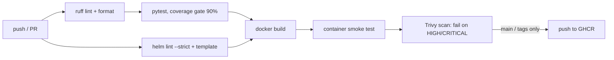

# url-shortener-service

[](https://github.com/shivanjalikaname/url-shortener-service/actions/workflows/ci.yml)

A small URL shortener API used as a reference for how I ship a service end to end:
tested code, a hardened container image, a Helm chart ready for Kubernetes, and a
CI pipeline that gates every change before an image is published.

The application is intentionally simple. The delivery pipeline around it is the point.

## Pipeline



| Stage | Why it's there |
|-------|----------------|
| Lint & format | Cheap, fast feedback; keeps diffs clean |
| Tests + coverage gate | Fails the build if coverage drops below 90% |
| Helm lint | Catches chart errors before they reach a cluster |
| Smoke test | Runs the real image and exercises create + redirect, catching packaging mistakes unit tests can't |
| Trivy | Blocks images with fixable HIGH/CRITICAL CVEs |
| Push | Only from `main` and `v*` tags; PRs never publish images |

Images are tagged `sha-<commit>`, `latest` (main) and `<semver>` (tags).

## API

| Method | Path | Description |
|--------|------|-------------|
| `POST` | `/api/v1/links` | Create a short link. Body: `{"url": "...", "code": "optional-custom"}` |
| `GET` | `/api/v1/links/{code}` | Look up a link |
| `GET` | `/{code}` | 307 redirect to the target URL |
| `GET` | `/healthz` | Liveness probe |
| `GET` | `/readyz` | Readiness probe |
| `GET` | `/metrics` | Prometheus metrics |

Interactive docs at `/docs` when running.

```bash
curl -X POST localhost:8000/api/v1/links \
  -H 'content-type: application/json' \
  -d '{"url": "https://example.com/some/long/path"}'
# {"code":"aZ3kP9q","short_url":"http://localhost:8000/aZ3kP9q","url":"https://example.com/some/long/path"}
```

## Run locally

```bash
python -m venv .venv && source .venv/bin/activate   # Windows: .venv\Scripts\activate
pip install -r requirements-dev.txt
uvicorn app.main:app --reload
pytest
```

With Docker:

```bash
docker build -t url-shortener .
docker run --rm --read-only -p 8000:8000 url-shortener
```

## Deploy to Kubernetes

```bash
helm upgrade --install shortener charts/url-shortener \
  --set image.tag=sha-<commit> \
  --set ingress.enabled=true --set ingress.host=sho.rt
```

The chart ships with:

- readiness/liveness probes wired to `/readyz` and `/healthz`
- zero-downtime rolling updates (`maxUnavailable: 0`)
- HorizontalPodAutoscaler (2–6 replicas on CPU) and a PodDisruptionBudget
- non-root, read-only root filesystem, all capabilities dropped, seccomp `RuntimeDefault`
- Prometheus scrape annotations

## Configuration

| Variable | Default | Description |
|----------|---------|-------------|
| `BASE_URL` | `http://localhost:8000` | Public base used to build `short_url` |
| `CODE_LENGTH` | `7` | Length of generated codes |
| `APP_VERSION` | `dev` | Reported by `/healthz`; set to the commit SHA in CI |

## Design notes

- **Bounded metric labels.** Metrics are labelled by route template (`/{code}`), never the raw path, so
  every new short link doesn't create a new Prometheus time series. There's a test for this.
- **Pluggable storage.** `MemoryStore` keeps the demo dependency-free; the narrow interface
  (`put/get/exists/ping`) is what a Redis or Postgres backend would implement, and `ping` is what
  the readiness probe checks.
- **Multi-stage image.** Wheels are built in a throwaway stage so the runtime image has no compiler,
  runs as a dedicated non-root user, and works with a read-only filesystem.

## License

MIT
